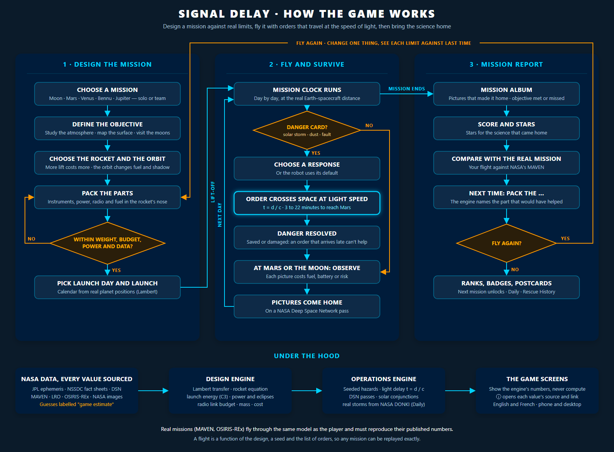

# Signal Delay: NASA Space Apps 2026 submission

Everything the Space Apps project form asks for, ready to paste, in the form's order. Fill in the four `[…]` placeholders before you submit:

| Placeholder | What goes there |
| --- | --- |
| `[LIVE GAME URL]` | The GitHub Pages address, e.g. `https://<org>.github.io/<repo>/` |
| `[REPO URL]` | The public GitHub repository, e.g. `https://github.com/<org>/<repo>` |
| `[DEMO URL]` | The public demo: a video of **30 seconds or less**, or slides (**7 or fewer**, title included) |
| `[TEAM]` | Team members and what each did (section 9) |

Challenge: **Space Mission Design Game**.

---

## 1. Project Name

```
Signal Delay
```

## 2. Summary (form limit: 1,500 characters, 50–200 words suggested)

169 words, 964 characters. Paste as is.

```
Signal Delay is a free browser game that puts players in charge of a NASA-style robotic mission, from the drawing board to the last picture sent home.

First they design it: pick a mission objective, choose a rocket and a science orbit, and pack instruments against four real limits shown live: weight, budget, power and data. Every choice is a trade-off.

Then they fly it. Every order crosses space at the speed of light, using the real Earth–spacecraft distance on that mission day, so a solar storm can reach the spacecraft before the command does. At Mars, the robot asks what to observe; each picture costs fuel, battery or risk and must come home through a Deep Space Network pass.

The Mission Report compares the flight with the real MAVEN mission and names one change to try next.

Every number comes from physics or a cited NASA source, and real missions fly through the same model as the player. Solo, team, online or kids mode; no install, no account.
```

## 3. Project Demonstration

```
[DEMO URL]
```

The link must open without a password or sign-in. Two options that meet the rules: a 30-second video (script below) or a 7-slide deck (outline below).

### Option A: 30-second video script

Record at 1440 × 900 from the judge link `[LIVE GAME URL]?play=mars&seed=2013`. Voice-over in English.

| Time | On screen | Voice-over |
| --- | --- | --- |
| 0–4 s | Home: an order crawling from Earth to Mars | "Mars is up to 22 light-minutes away. Every order you send arrives late." |
| 4–10 s | Briefing: pick MAP THE SURFACE; Pack: hover the camera, the four limit bars move | "Design the mission: an objective, then weight, budget, power and data, all real limits." |
| 10–14 s | ROCKET tab → Atlas V 411; ORBIT tab → compare the three orbits | "A bigger rocket lifts more and costs more. The orbit changes fuel, moons and shadows." |
| 14–21 s | Launch; a solar storm card: "danger arrives in …" vs "your order takes …" | "Then fly it. Will your order cross space before the storm does?" |
| 21–26 s | Mars globe: OBSERVE a target; the picture prints on the teletype | "At Mars, choose what to observe. Each picture has to come home." |
| 26–30 s | Mission Report: album, comparison with MAVEN, NEXT TIME line | "Real NASA data, real physics. Change one thing and fly again. Signal Delay." |

### Option B: 7-slide outline

1. **Signal Delay.** A deep-space mission game built on real NASA data and real orbital physics. Team name, challenge name, `[LIVE GAME URL]`.
2. **The problem.** Mission design is a web of trade-offs, and the hardest part of robotic exploration is that nobody is there. Both are invisible to students.
3. **Design.** Objective, rocket, science orbit and parts, against weight, budget, power and data. *(Pack screenshot, `docs/images/pack.png`.)*
4. **Fly & Survive.** Light-delayed orders, solar storms from NASA DONKI, DSN passes, conjunction blackouts. *(Danger card, `docs/images/fly-danger-card.png`.)*
5. **Bring the science home.** Six Mars targets and four Moon targets, real NASA pictures, the Mission Report against MAVEN. *(`docs/images/report.png`.)*
6. **How it works.** The flow chart (`docs/images/flowchart.png`). Every value sourced (`Sourced<T>`), one model for players and real missions, validated against MAVEN and OSIRIS-REx (e.g. transfer time 300 vs 307 days).
7. **Play together.** Team Mode with four roles, online rooms on phones, Space Kids for ages 4–10, English and French. Call to action: the link.

## 4. Project (public link)

```
[LIVE GAME URL]
```

If the form allows only one link, use the live game: it opens with no install, password or account. The repository is linked from the game's ⓘ ABOUT panel and from the Project Details below.

## 5. Project Details

Paste into the rich-text editor. Headings can be set to bold. Insert the flow chart (`docs/images/flowchart.png`, 1600 × 1180; the editable source is `flowchart.svg`) after "What it does", and use it as a slide in Option B.



---

**What it does**

Signal Delay turns the work of a NASA mission team into a game in three steps.

1. **Design (Pack).** The player picks a mission objective (study the atmosphere, map the surface, or visit the moons), chooses a rocket and a science orbit, and packs parts into the rocket's nose. Four limits update as they design: weight, budget, power and data. Hovering a part previews every bar before it is packed. A bigger rocket lifts more but costs more; a high orbit saves fuel and reaches Deimos but makes Phobos expensive.
2. **Fly & Survive.** The mission runs day by day. Danger cards (solar storms, dust storms, faults) stop the clock. The player chooses a response, and the order travels to the spacecraft at the speed of light, using the real Earth–spacecraft distance on that day. Solar conjunctions black out the radio for about two weeks, as they do for real Mars missions. At Mars the robot asks what to look at: six science targets, each picture costing fuel, battery or risk, each one coming home through a Deep Space Network pass.
3. **Mission Report.** The album of pictures that made it home, whether the objective was met, the robot's last message, the flight as a comic strip, a comparison with the real NASA mission (MAVEN at Mars), and the one part that would have helped. FLY AGAIN returns to the same design and shows each limit against the last flight: change one thing and fly again.

Seven missions teach one idea each: power and fuel at the Moon, light delay and the full design at Mars, budget at Venus, rendezvous at the asteroid Bennu, and why real missions to Jupiter need gravity assists.

**How it addresses the challenge**

The challenge asks for a game where players design a space mission. In Signal Delay the player defines the objective, chooses the launch vehicle and the orbit, and sees budget, mass, power and data as limits while designing, then flies the design and sees the consequences. A judge link (`[LIVE GAME URL]?play=mars&seed=2013`) opens the Mars mission directly on a fixed flight, and the README has a three-minute route through all of it.

**How it works**

- **A real simulation engine** in TypeScript. It computes Lambert transfers between real launch and arrival dates, the rocket equation, payload against launch energy (C3), solar power by the inverse-square law with eclipses, batteries, a radio link budget anchored to Mars Reconnaissance Orbiter, and light delay t = d / c.
- **Planet positions** from JPL's approximate Keplerian elements, for every day of the mission.
- **Every number is sourced.** Each constant is stored with its value, unit, source and link, and the game shows that record with ⓘ. A value with no public source (a failure chance, a part price) is labelled "game estimate" in the game itself. An automated test fails if any number in the data is not sourced.
- **One model for everyone.** Real missions (MAVEN, OSIRIS-REx, LRO/LCROSS) are loaded as ordinary designs and must reproduce their published numbers. The engine finds MAVEN's transfer at 300 days against 307 published, its rocket-equation Δv within 0.1%, its best launch date inside the real launch period, and the 2015 Mars conjunction blackout at 13.9 days against 14.
- **Live NASA data.** The Daily mission uses the real Sun: solar energetic particle events and coronal mass ejections from NASA's DONKI database (with WSA-ENLIL arrival predictions) from the past week become that day's danger cards. Home shows today's Earth–Mars distance, light time and the next solar conjunction.
- **Real pictures.** The Mars and Moon targets and the postcards are real NASA images (Viking, MRO HiRISE, Mars Odyssey THEMIS, LROC), each checked against its catalogue page.
- **Deterministic.** A mission is a function of the design, a seed and the list of orders, so any flight can be replayed exactly. That is what keeps every phone in an online room in step.

**Benefits and intended impact**

- **For students and classrooms:** it makes two invisible ideas tangible. Mission design is a set of trade-offs, not a shopping list. And a spacecraft millions of kilometres away cannot be steered in real time.
- **For teamwork:** Team Mode puts up to four players around one screen as Flight Director, Spacecraft Engineer, Science Lead and Comms & Ops, with votes on danger cards. Online Rooms let each player join on a phone with a room code. Players talk through preset messages only and type no names, so it is safe for children.
- **For younger players:** Space Kids is the same loop made simple for ages 4–10, with big parts, no numbers on the way, and real NASA facts at the end.
- **For curious adults:** Engineer mode opens every number to its equation, inputs and source.
- **Lessons from real history:** Rescue History lets players investigate Mars Climate Orbiter (1999), lost to a pound-force versus newton mix-up, from its published failure report.
- **Free and open:** a static website, no install, no account, MIT-licensed code, English and French.

**Tools, languages and software**

TypeScript (strict), React 19, Vite 8, three.js (the 3D globes, with a 2D fallback), Supabase Realtime (online room relay, public key only, nothing stored), Vitest, Testing Library and Playwright for automated tests and screenshots, GitHub Actions and GitHub Pages for hosting. The automated tests cover physics, validation against real missions, a data audit, UI guards and player journeys, and every deploy runs them first.

**What makes it creative**

Light delay is the core mechanic, not decoration: the player watches their order crawl across space against an incoming storm. The danger cards come from the real Sun of the past week. And the game compares the player with the real mission team that flew the same route.

**Factors we considered**

- **Scientific honesty:** we never present a guess as NASA data. Estimates are labelled in the game and listed in the repository (`TODO_DATA.md`). Known model limits are written down, for example: no gravity assists, approximate ephemeris, and placeholder Atlas V payload curves until NASA Launch Services Program points are exported by hand.
- **Accessibility:** works on desktop and phone, respects reduced-motion settings, has keyboard controls, and needs no sound.
- **Child safety:** no accounts, no free text in team play, call signs instead of names.
- **Image rights:** only NASA pictures used under the JPL Image Use Policy and NASA media guidelines, each credited.
- **Not affiliated with NASA:** no NASA insignia or logotype; mission names are used only to identify the real missions whose published data we cite.

Source code: `[REPO URL]`

---

## 6. Use of Super Intelligence (SI)

**Select in the form:** the code option (*code and data*). Do not select images, video or audio: the game has no AI-generated pictures, video or sound.

Text to keep in the repository (README "Acknowledgements" section) so judges can see it, as the form requires for code:

```
Use of AI: Code in this repository was written with Claude Code (Anthropic), an AI coding assistant, working under our direction. We wrote the specification and the rules, chose every data source, and reviewed and tested the work. Every number in the game comes from a cited source or is labelled a game estimate. No images, video or audio in the game were generated by AI: all pictures are real NASA images, credited in the game and in the README.
```

The commit history already marks the AI-assisted commits with a `Co-Authored-By: Claude` line, which serves as the metadata.

## 7. NASA Data (Link Text → Link URL)

Add one row per resource with **+ Add New Link**.

| Link Text | Link URL |
| --- | --- |
| NASA NSSDC Mars Fact Sheet | https://nssdc.gsfc.nasa.gov/planetary/factsheet/marsfact.html |
| NASA NSSDC Venus Fact Sheet | https://nssdc.gsfc.nasa.gov/planetary/factsheet/venusfact.html |
| NASA NSSDC Jupiter Fact Sheet | https://nssdc.gsfc.nasa.gov/planetary/factsheet/jupiterfact.html |
| NASA NSSDC Moon Fact Sheet | https://nssdc.gsfc.nasa.gov/planetary/factsheet/moonfact.html |
| NASA Planetary Fact Sheet | https://nssdc.gsfc.nasa.gov/planetary/factsheet/index.html |
| JPL Approximate Positions of the Planets | https://ssd.jpl.nasa.gov/planets/approx_pos.html |
| JPL Small-Body Database: 101955 Bennu | https://ssd.jpl.nasa.gov/tools/sbdb_lookup.html#/?sstr=101955 |
| NASA GISS Mars24 technical notes | https://www.giss.nasa.gov/tools/mars24/help/notes.html |
| NASA DONKI space weather database (CCMC DONKI-API) | https://ccmc.gsfc.nasa.gov/DONKI-API/get/ |
| NASA Science: MAVEN | https://science.nasa.gov/mission/maven/ |
| NASAfacts: MAVEN Orbit Insertion | https://science.nasa.gov/wp-content/uploads/2024/03/44740_MAVEN-Fact-Sheet.pdf |
| NASA: The 2013 MAVEN Mission to Mars | https://mars.nasa.gov/files/resources/MAVENPresentation2013.pdf |
| NASA MAVEN blog: solar conjunction, Dec 2025 | https://science.nasa.gov/blogs/maven/2025/12/23/nasa-works-maven-spacecraft-issue-ahead-of-solar-conjunction/ |
| JPL DESCANSO: MAVEN orbit (AAS 21-211) | https://descanso.jpl.nasa.gov/evolution/AAS%2021-211.pdf |
| NASA Science: LRO | https://science.nasa.gov/mission/lro/about/ |
| NASA Science: LCROSS | https://science.nasa.gov/mission/lcross/ |
| NASA NTRS 20100028203 (LCROSS) | https://ntrs.nasa.gov/citations/20100028203 |
| NASA NTRS 20080012683 (LRO station-keeping) | https://ntrs.nasa.gov/citations/20080012683 |
| NASA Science: Juno | https://science.nasa.gov/mission/juno/ |
| NASA Science: Mars Climate Orbiter | https://science.nasa.gov/mission/mars-climate-orbiter/ |
| NASA/JPL Mars Climate Orbiter arrival press kit | https://mars.nasa.gov/internal_resources/812/ |
| Mars Climate Orbiter Mishap Investigation Board Report | https://discovery.larc.nasa.gov/PDF_FILES/MCO_report_2.pdf |
| NASA MMRTG fact sheet | https://science.nasa.gov/wp-content/uploads/2024/02/mmrtg-factsheet-updated-5-18-20-1.pdf |
| JPL D-101146 Energy Storage Technologies report | https://solarsystem.nasa.gov/system/downloadable_items/716_Energy_Storage_Tech_Report_FINAL.PDF |
| JPL DESCANSO Article 12: MRO Telecommunications | https://descanso.jpl.nasa.gov/DPSummary/MRO_092106.pdf |
| NASA DSN 810-005 module 101 | https://deepspace.jpl.nasa.gov/dsndocs/810-005/101/101I.pdf |
| NASA DSN 810-005 module 104 | https://deepspace.jpl.nasa.gov/dsndocs/810-005/104/104Q.pdf |
| NASA Mission Operations and Communications Services | https://deepspace.jpl.nasa.gov/files/6_NASA_MOCS_2014_10_01_14.pdf |
| JPL: Mars missions pause commanding (2015 conjunction) | https://www.jpl.nasa.gov/news/mars-missions-to-pause-commanding-in-june-due-to-sun/ |
| NASA Discovery 2019 AO overview (cost cap) | https://discovery.larc.nasa.gov/PDF_FILES/03a_Brown_Overview.pdf |
| NASA Launch Services Program performance site | https://elvperf.ksc.nasa.gov/ |
| NASA/NOAA: Sun reaches solar maximum (2024) | https://science.nasa.gov/science-research/heliophysics/nasa-noaa-sun-reaches-maximum-phase-in-11-year-solar-cycle/ |
| NASA: The Fact and Fiction of Martian Dust Storms | https://www.nasa.gov/solar-system/the-fact-and-fiction-of-martian-dust-storms/ |
| NASA Photojournal PIA02982 Olympus Mons | https://science.nasa.gov/photojournal/color-mosaic-of-olympus-mons/ |
| NASA Photojournal PIA00422 Valles Marineris | https://pds-rings.seti.org/press_releases/pages/PIA00xxx/PIA00422.html |
| NASA Photojournal PIA00161 Mare Boreum | https://science.nasa.gov/photojournal/mc-1-mare-boreum-region |
| NASA Photojournal PIA10368 Phobos | https://science.nasa.gov/photojournal/phobos-from-6800-kilometers-color/ |
| NASA PIA11826 Deimos in High Resolution | https://science.nasa.gov/resource/martian-moon-deimos-in-high-resolution/ |
| NASA Photojournal PIA26203 THEMIS Mars horizon | https://science.nasa.gov/photojournal/odysseys-themis-views-the-horizon-of-mars |
| NASA Photojournal PIA26055 Olympus Mons | https://science.nasa.gov/photojournal/pj-olympus-mons-26/ |
| LROC NAC frame M175124932R (Apollo 11 site) | https://data.lroc.im-ldi.com/lroc/view_lroc/LRO-L-LROC-3-CDR-V1.0/M175124932RC |
| LROC NAC frame M162350671L (Tycho) | https://data.lroc.im-ldi.com/lroc/view_lroc/LRO-L-LROC-3-CDR-V1.0/M162350671LC |
| LROC NAC frame M1346257675L (Shackleton) | https://data.lroc.im-ldi.com/lroc/view_lroc/LRO-L-LROC-3-CDR-V1.0/M1346257675LC |
| LROC NAC frame M113107391L (Tsiolkovskiy) | https://data.lroc.im-ldi.com/lroc/view_lroc/LRO-L-LROC-3-CDR-V1.0/M113107391LC |
| NASA SVS CGI Moon Kit (Moon globe) | https://svs.gsfc.nasa.gov/4720 |
| NASA Image and Video Library (postcard pictures) | https://images.nasa.gov/ |
| JPL Image Use Policy | https://www.jpl.nasa.gov/jpl-image-use-policy |

The postcards come from these NASA Image Library pages: Earthrise (`GSFC_20171208_Archive_e000496`), Sunrise on Tycho (`GSFC_20171208_Archive_e001873`), Apollo 11 from above (`PIA12909`), the whole red planet (`PIA00407`), dunes (`PIA18244`), Victoria Crater (`PIA12167`), Venus (`PIA00104`, `PIA00254`, `PIA00461`), Bennu (`2019-02-25_regolith_image_compilation`, `NHQ202309240006`, `DSCN0130`). Each is `https://images.nasa.gov/details/<id>`; add them one by one if you want every image listed separately.

## 8. Space Agency Partner & Other Data

| Link Text | Link URL |
| --- | --- |
| NOAA Space Weather Scales (storm rates) | https://www.spaceweather.gov/noaa-scales-explanation |
| NOAA SWPC solar cycle 24 | https://www.swpc.noaa.gov/news/sun-solar-maximum-solar-cycle-24-seeing-second-higher-peak-sunspot-number-updated |
| NOAA SWPC solar flare classes | https://www.swpc.noaa.gov/phenomena/solar-flares-radio-blackouts |
| USGS Astrogeology: Mars Viking Colorized Global Mosaic (Mars globe) | https://astrogeology.usgs.gov/search/map/mars_viking_colorized_global_mosaic_232m |
| IAU/USGS Gazetteer of Planetary Nomenclature | https://planetarynames.wr.usgs.gov/ |
| Lauretta et al. 2017, OSIRIS-REx mission description (arXiv) | https://arxiv.org/pdf/1702.06981 |
| NIST SP 811 (unit conversions) | https://www.nist.gov/pml/special-publication-811 |
| React (MIT) | https://react.dev/ |
| Vite (MIT) | https://vitejs.dev/ |
| three.js (MIT) | https://threejs.org/ |
| TypeScript (Apache 2.0) | https://www.typescriptlang.org/ |
| Supabase Realtime (online room relay) | https://supabase.com/docs/guides/realtime |
| Vitest (MIT) | https://vitest.dev/ |
| Playwright (Apache 2.0) | https://playwright.dev/ |
| Testing Library (MIT) | https://testing-library.com/ |
| jsdom (MIT) | https://github.com/jsdom/jsdom |
| nodeenv | https://github.com/ekalinin/nodeenv |
| Google Fonts: Space Grotesk (OFL) | https://fonts.google.com/specimen/Space+Grotesk |
| Google Fonts: Orbitron (OFL) | https://fonts.google.com/specimen/Orbitron |
| Google Fonts: JetBrains Mono (OFL) | https://fonts.google.com/specimen/JetBrains+Mono |
| GitHub Pages and GitHub Actions (hosting) | https://pages.github.com/ |
| Claude Code (AI coding assistant, see SI section) | https://claude.com/claude-code |
| Signal Delay source code | `[REPO URL]` |

Three Mars target pictures (Phobos, Deimos, the limb) are NASA releases whose terms are "third-party: educational and personal use" (HiRISE: University of Arizona; THEMIS: Arizona State University). They are credited in the game and the README, which this project's educational use fits.

## 9. Team

`[TEAM]`: one line per member, for example:

```
<Name> — simulation engine and physics
<Name> — interface and design
<Name> — NASA data research and validation
<Name> — demo, testing and documentation
```

Also update `src/ui/about.ts` (team name, members, repository URL), which the in-game ⓘ ABOUT panel shows. It still says "Our Team" and "Member One/Two/Three".

## 10. Before you press Submit

- [ ] The live game opens from `[LIVE GAME URL]` in a private window, with no sign-in.
- [ ] The judge link `[LIVE GAME URL]?play=mars&seed=2013` opens Red Planet.
- [ ] The demo is public and is 30 seconds or less (video) or 7 slides or fewer.
- [ ] The README and `src/ui/about.ts` no longer contain `YOUR-ORG`, `YOUR-REPO` or "Member One".
- [x] The README's AI-use text (section 6) is in the repository (README, "Acknowledgements and disclaimer").
- [ ] Every NASA and other resource is listed in sections 7 and 8.
- [ ] Both verification boxes are ticked: Terms and Conditions, and All Work is Original.
